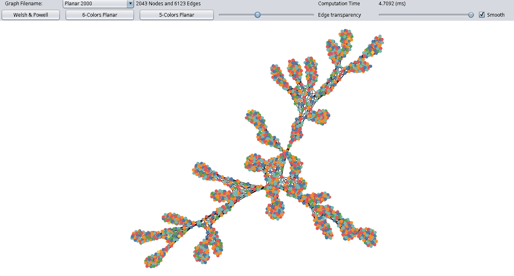

# Visualiseur de Coloriage de Graphe

[English Version](README.md)



Graph Coloring Visualizer est une application Java conçue pour explorer et visualiser divers algorithmes de coloriage de graphes. Elle fournit une interface utilisateur graphique (GUI) pour interagir avec les graphes, appliquer des algorithmes de coloriage et observer les résultats en temps réel.

## Prérequis

- Java JDK (Java 21 ou supérieur recommandé)
- Apache Ant

## Comment Compiler & Exécuter

### Utilisation d'Apache Ant

1. **Compiler le projet :**
   ```bash
   cd SAE2-etd-3-initial
   ant compile
   ```

2. **Lancer l'application :**
   ```bash
   ant run
   ```

### Compilation & Exécution Manuelle

1. Compiler les fichiers sources :
   ```bash
   javac -d build/classes -sourcepath src src/info/iut/sae2/Main.java
   ```

2. Lancer l'application :
   ```bash
   java -cp build/classes info.iut.sae2.Main
   ```

## Comment Utiliser

Lorsque vous lancez le Visualiseur de Coloriage de Graphe, une fenêtre apparaîtra affichant le canevas du graphe. Vous pouvez interagir avec l'application via les menus et contrôles fournis dans l'interface :

- **Charger un Graphe** : Ouvrir un jeu de données de graphe pour le visualiser.
- **Algorithmes de Coloriage** : Sélectionner et exécuter différents algorithmes de coloriage (ex: Glouton, Welsh-Powell) pour voir comment le graphe est coloré.
- **Contrôles de Visualisation** : Ajuster la disposition et l'apparence des nœuds et des arêtes pour une meilleure clarté.
- **Analyse** : Afficher le nombre de couleurs utilisées et d'autres statistiques pertinentes pour l'algorithme appliqué.

## Algorithmes Implémentés

- **Welsh & Powell** : Coloriage glouton heuristique triant les sommets par degré décroissant ($O(V^2)$). Colorie ~2 000 sommets / ~6 100 arêtes en **~5 ms**.
- **6-Couleurs Planaire** : Coloriage récursif exploitant la propriété que tout graphe planaire possède au moins un sommet de degré $\le 5$.
- **5-Couleurs Planaire** : Réduction basée sur les chaînes de Kempe garantissant un maximum de 5 couleurs sur les graphes planaires.

## Structure du Projet

```text
SAE2-etd-3-initial/
├── src/               # Code source Java (modèle de graphe, algorithmes, UI Swing)
├── test/              # Tests unitaires
├── dataset/           # Fichiers de graphes de test (Simple sample, Planar 100, Planar 2000...)
├── img/               # Captures d'écran pour la documentation
├── umInitial.uxf      # Diagramme de classes UML (UMLet)
└── build.xml          # Configuration de build Apache Ant
```
