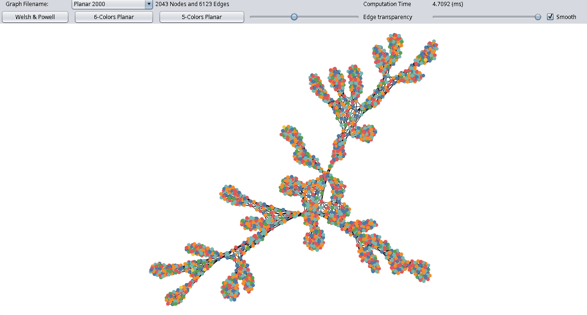

# Graph Coloring Visualizer

[Version Française](README.fr.md)



Graph Coloring Visualizer is a Java-based application designed to explore and visualize various graph coloring algorithms. It provides a graphical user interface (GUI) to interact with graphs, apply coloring algorithms, and observe the results in real-time.

## Requirements

- Java JDK (Java 21 or higher recommended)
- Apache Ant

## How to Compile & Run

### Using Apache Ant

1. **Compile the project:**
   ```bash
   cd SAE2-etd-3-initial
   ant compile
   ```

2. **Run the application:**
   ```bash
   ant run
   ```

### Manual Compilation & Execution

1. Compile source files:
   ```bash
   javac -d build/classes -sourcepath src src/info/iut/sae2/Main.java
   ```

2. Run the application:
   ```bash
   java -cp build/classes info.iut.sae2.Main
   ```

## How to Use

When you launch the Graph Coloring Visualizer, a window will appear displaying the graph canvas. You can interact with the application using the menus and controls provided in the interface:

- **Load Graph**: Open a graph dataset to visualize.
- **Coloring Algorithms**: Select and execute different coloring algorithms (e.g., Greedy, Welsh-Powell) to see how the graph is colored.
- **Visualization Controls**: Adjust the layout and appearance of the nodes and edges for better clarity.
- **Analysis**: View the number of colors used and other relevant statistics for the applied algorithm.

## Implemented Algorithms

- **Welsh & Powell**: Heuristic greedy coloring ordering vertices by descending degree ($O(V^2)$). Colors ~2,000 nodes / ~6,100 edges in **~5 ms**.
- **6-Colors Planar**: Recursive coloring exploiting the property that every planar graph has at least one vertex of degree $\le 5$.
- **5-Colors Planar**: Kempe chain-based reduction guaranteeing a maximum of 5 colors on planar graphs.

## Project Structure

```text
SAE2-etd-3-initial/
├── src/               # Java source code (graph model, coloring algorithms, Swing UI)
├── test/              # Unit tests
├── dataset/           # Graph test files (Simple sample, Planar 100, Planar 2000...)
├── img/               # Documentation screenshots
├── umInitial.uxf      # UML class diagram (UMLet)
└── build.xml          # Apache Ant build configuration